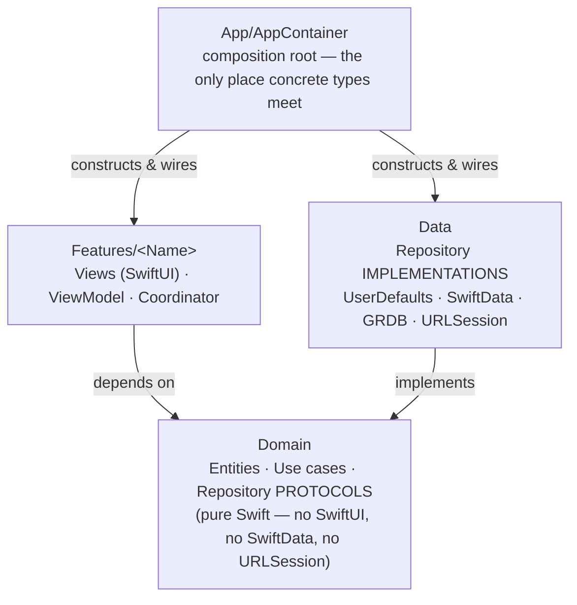
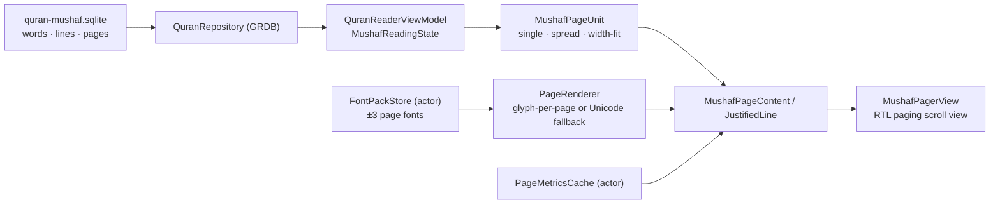
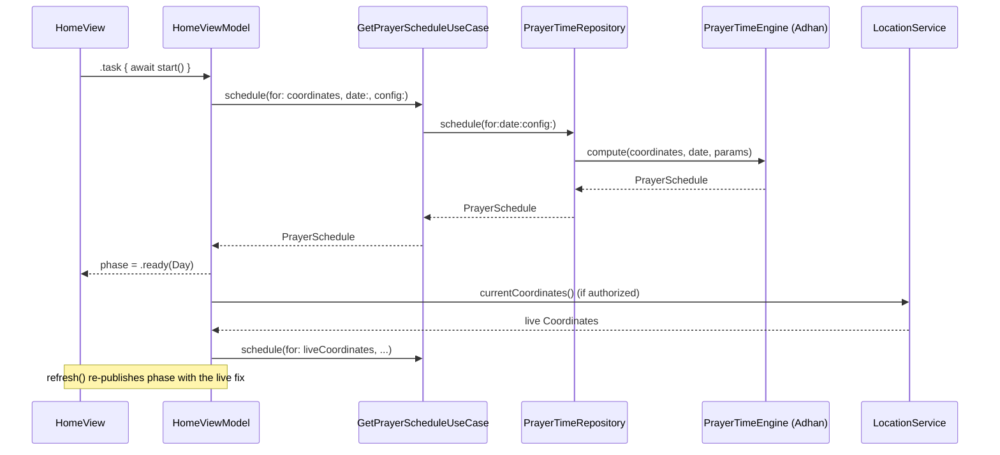

# Architecture

Noor is a Clean Architecture / MVVM-C app, in one SwiftUI codebase that ships
to iPhone, iPad, and macOS. This document is the map of *why* it is shaped
this way — for the folder-by-folder rules an editor should follow while
writing code in it, see [`CLAUDE.md`](CLAUDE.md), which this file assumes as
background rather than repeats.

## Layers, and the rule between them



**Features depend on Domain. Data implements Domain. Neither depends on the
other.** A view model asks a repository *protocol* for a `PrayerSchedule` or
a list of adhkar; it has no idea whether the answer came from Adhan's
astronomy, a SwiftData query, or a GRDB read against a bundled SQLite file.
That swap happens once, in `AppContainer` — the composition root — which is
the only file in the app allowed to write `UserNotificationCenterClient()` or
`PrayerTimeEngine()` by name.

This buys two things a typical MVVM app doesn't get for free:

- **Every use case is unit-testable without a simulator.** Domain has no
  SwiftUI, UIKit, SwiftData, or URLSession import, so a `GetPrayerScheduleUseCase`
  test hands it a fake repository and asserts on plain Swift values.
- **The storage technology is swappable in one place.** `PersistenceController`
  is the only file that knows the mutable-data store is SwiftData; `CorpusDatabase`
  is the only file that knows the reference content is GRDB over SQLite. Neither
  fact leaks past its own `Data/` folder.

## Repeating shape: `Core/<Subsystem>`

Every cross-cutting subsystem under `Core/` repeats the same three-way split,
one level down:

```
Core/<Subsystem>/
  Domain/   protocols + entities — pure Swift, no SwiftUI / SwiftData / URLSession
  Data/     implementations — UserDefaults, SwiftData, URLSession, GRDB, CoreLocation…
  UI/       SwiftUI glue — @Observable @MainActor managers, @Entry environment values
```

`Core/Location`, `Core/Notifications`, `Core/Persistence` and every subsystem
under `Shared/` all follow it. Knowing the pattern once means knowing where to
look in any of them: the protocol is always in `Domain`, the framework import
is always in `Data`.

## `Shared/` — the code two processes run

There are two source roots, not one. `Shared/` is compiled into **both** the
app and the widget extension; `ThawabForGod/` is the app alone.

The line between them is one rule: *a subsystem belongs in `Shared/` when a
second process needs it and it costs no heavy dependency to take.* Everything
there imports Foundation, SwiftUI, Observation or Adhan and nothing else —
which is what keeps the widget's link line short and its memory inside
WidgetKit's budget. Anything with SwiftData, GRDB, CoreLocation,
UserNotifications or a corpus file behind it stays in `Core/`.

The subsystems themselves are unchanged: same `Domain/Data/UI` split, same
files. What moved is where they are compiled, not how they are shaped.

## Folder map

```
Shared/            Compiled into BOTH targets — see the rule above
├── PrayerTimes/       Adhan-backed engine — also the Qibla bearing's source
├── Settings/          The one key/value store every preference writes through,
│                      plus the App Group both processes read it from
├── Localization/      AR/EN strings, digit system, clock format
├── Theming/           Accent + appearance, no view ever branches on colorScheme
├── Clock/             The current instant, and a heartbeat
├── DeepLink/          The app's external URL vocabulary — a widget's way back in
├── Quran/             Verse identity and the ayah-end marker the app and widgets share
├── Widgets/           Timelines, snapshots and the widget views the app's tests can reach
└── Resources/         Localizable.xcstrings + the namespaced colour assets

ThawabForGod/       The app target
├── App/            Composition root: AppContainer (manual DI), app entry, routing
├── Core/           Cross-cutting infra — one Domain/Data/UI split per subsystem
│   ├── Location/       CoreLocation behind a one-shot, permission-aware protocol
│   ├── Notifications/  Rolling reminder window + BGTaskScheduler background refill
│   ├── Persistence/    SwiftData (mutable) + Corpus/ (read-only GRDB over SQLite)
│   ├── Layout/         FoldGeometry — where a foldable display divides
│   ├── Search/         Arabic query folding + FTS5 expressions, shared by two corpora
│   ├── Memorization/   SM-2 spaced repetition, as a pure function of state and grade
│   ├── Networking/     Optional by design — no core feature may require it
│   ├── Widgets/        Telling the widgets their inputs changed
│   ├── MacIntegration/ Menu-bar preferences and the login item (macOS)
│   └── Tips/           TipKit configuration
├── Features/       One folder per feature: Views + ViewModel + Coordinator
│   ├── Home/           Prayer times + next-prayer countdown
│   ├── Quran/          The Madina mushaf and separated reading, ayah panel, search, marks
│   ├── Hadith/         The two Sahihs: browse, search, bookmarks, memorization
│   ├── MenuBar/        The Mac's status item and the panel it opens
│   ├── Onboarding/     First-run: permissions, calculation method
│   ├── Qibla/          Compass + distance, reusing the prayer-time engine
│   ├── Adhkar/         Morning/evening remembrance, the first corpus reader
│   ├── Tasbih/         Electronic counter — corpus phrases, SwiftData counts
│   ├── NamesOfAllah/   The 99 names, read-only, in-memory search
│   └── Settings/       Drives every preference above; stores none of its own
└── Resources/      App-only assets, the bundled read-only .sqlite corpora and Packs/, fonts, licences
```

## The Quran, as built

`Features/Quran` is the largest feature and the one with the most moving
parts, so it has its own map. The decisions behind it are in
[`QURAN_MIGRATION_PLAN.md`](QURAN_MIGRATION_PLAN.md) and the per-task notes in
[`docs/quran-migration/`](docs/quran-migration/); the rules a contributor must
not break are in [`CLAUDE.md`](CLAUDE.md).

### Layers

The feature repeats the app's split inside its own folder:

```
Features/Quran/
  Domain/       Entities, repository protocols, pure rules — Foundation only
                (QuranCapabilities, QuranRepositoring, QuranUserData, GoToTarget …)
  Data/         GRDB repositories over the corpus, the content-pack stores, the
                page-font store, and the SwiftData user-data repository
  Library/ Reader/ Mushaf/ Separated/ AyahPanel/ Search/ Bookmarks/
  Settings/ Tafsir/ Translation/ Commands/ Widgets/    Views + view models
  QuranCoordinator.swift                                Typed path + panel state
```

`QuranCoordinator` owns the section's `[QuranRoute]` path and the ayah panel's
state (which ayah, sheet or side column or bottom half), outside the view tree,
so an iPad changing arrangement, a deep link, or a widget tap reaches the reader
without touching a view. `App/NavigationPathBinding.swift` adapts that typed
path to the `NavigationPath` every section's `NavigationStack` binds — the
split view's detail column compares paths across sections, and mixed path types
trapped inside SwiftUI.

Two small pieces live outside the feature because a second consumer needs them:
`Packages/ArabicText` (the one Arabic folding rule, used by the app's search and
by the data builder) and `Core/Layout/FoldGeometry` (the one place a display's
fold is measured).

### Data profiles

One schema, two builds of it, written only by `Tools/QuranBuilder`:

| | `tanzil` (public) | `qul` (full) |
| --- | --- | --- |
| Database | `quran.sqlite` — text, divisions, search | `quran-mushaf.sqlite` — the same plus the printed Madani V2 layout, word-by-word text, glyph codes, ligatures |
| Packs | `tafsir-ar-jalalayn` | Saheeh International, Al-Muyassar, Al-Mukhtasar, English surah introductions (plus Jalalayn) |
| Fonts | KFGQPC Hafs, Amiri Quran (committed) | and 604 page fonts + header, surah-name and juz-name faces |
| In git | yes | never — QUL publishes no licence |
| Reading | separated mode | Mushaf mode and separated mode, Library Page tab |

`QuranDatabase` opens the full file when it is bundled and the public one
otherwise; what the app then offers comes from the file's `meta.capabilities`
(`QuranCapabilities`), never from which file it is. A Release build fails
without the full data (the "Check Quran full data" build phase); a Debug build
warns, so a public clone builds and runs. Sources, pins and what is verified:
[`ThawabForGod/Resources/Corpus/README.md`](ThawabForGod/Resources/Corpus/README.md).

### Packs

Translations, tafsirs and surah introductions are one SQLite file each, named by
kind (`translation-`, `tafsir-`, `surah-info-`) and describing themselves in a
`pack` table, so the app finds them by prefix and there is no manifest to keep in
step. `ContentPackStore` lists what is installed; `QuranReaderSettings` holds
which are enabled and in what order (`nil` means every installed pack, `[]` means
none). A tafsir may have no row for a verse — Jalalayn passes over 226 — and that
is an answer (`nil`, shown as "this commentary has no note here"), never a
neighbour's text.

### Rendering pipeline



- Each page is drawn in its own font; `FontRegistrar` skips that folder at launch
  and `FontPackStore` registers a window around the current page.
- A page whose font is missing is drawn from the same words in KFGQPC Hafs
  (`PageRenderer`), not left blank.
- The page/spread/width-fit decision is made from the **detail column's** size,
  not the screen's, so a spread fits beside a sidebar.
- Separated mode (`SeparatedReaderView`) is a lazy list of ayah rows with each
  enabled translation under the Arabic.
- The Quran text is drawn, never changed: `QuranAyahText` only sets attributes
  on sub-ranges of the stored string.

### User data

Bookmarks, notes, highlights (one per ayah per kind) and the single reading
position are SwiftData rows behind a `@ModelActor` (`QuranUserDataRepository`),
keyed on `(surah, verse)`. `QuranUserDataStore` is the main-actor mirror views
read per ayah while drawing; writes are optimistic and serialised on one chain.
The position stores an ayah, not a page, and is debounced.

### Widgets

Two kinds in `NoorWidgets` — Continue Reading and Ayah of the Day — which cannot
open a corpus. The app's `QuranWidgetPublisher` writes a `QuranWidgetSnapshot`
(the position, and the **whole** curated ayah-of-the-day list with its text) into
the App Group, and copies the Hafs and Amiri faces beside it; the extension
picks the day with `DailyAyahRule` on its own clock. The timeline and the views
are in `Shared/Widgets`, so the app's test target can test and render them. A tap
opens `noor://quran/verse/<s>/<v>` or `noor://quran/page/<n>`.

### Platforms

- **iPhone:** tab bar; the panel is a sheet; the tab bar hides in landscape.
- **iPad:** sidebar; the panel is a trailing column in landscape and a sheet in
  portrait; hardware-keyboard paging.
- **Duo / folds:** `FoldGeometry` gives the spread its gutter, the panel the
  trailing half, and tabletop a page above and a panel below.
- **Mac:** sidebar; the panel is always a trailing column; a Quran menu enabled
  only while the Quran is the selected section; ← → paging lives in a key event
  monitor because menu key equivalents never fired under the scroll view.
- **Never `.inspector` in the split view's detail column** — it pops the pushed
  screen. The panel is `AyahSidePanel`, an ordinary `HStack` child.

## Data flow: a screen appearing

Home's launch path is representative of how every feature is wired — nothing
in a `View` ever constructs a concrete type:



The seeded (onboarding, or Makkah) coordinates draw the first frame
immediately; a live fix, once `LocationService` can produce one, silently
replaces it without the screen ever sitting on a loading state waiting for
GPS.

## Concurrency

`SWIFT_DEFAULT_ACTOR_ISOLATION = MainActor` — every declaration in the module
is implicitly main-actor-isolated unless marked `nonisolated`. That is a
deliberate default for a UI-heavy app, but it means background work (a GRDB
read, a `URLSession` call, a `@ModelActor`) needs *deliberate* isolation
reasoning, not a reflexive `@MainActor` on everything. A few load-bearing
examples:

- `CorpusDatabase` reads land off the main actor for free — GRDB dispatches
  the body of `read` onto the database's own queue, whatever actor asked.
- `TasbihProgressRepository` is a `@ModelActor`, so SwiftData writes happen on
  their own actor even though the view model calling it is `@MainActor`.
- `ReachabilityMonitor` and `UserNotificationService` are `@MainActor`
  explicitly, documenting that they are UI-facing rather than relying on the
  module default to make that true.

The language mode is still Swift 5 (`SWIFT_VERSION = 5.0`), but new code is
written as if strict concurrency were already on — explicit isolation,
`Sendable` at the boundaries — so flipping the switch later is a non-event.
`xcodebuild … SWIFT_VERSION=6.0` (see the README) is how that gets checked
without touching the project's real setting.

## Testing

Two frameworks, deliberately: unit tests use **Swift Testing**
(`ThawabForGodTests`), UI tests stay on **XCTest** (`ThawabForGodUITests`).
Domain use cases, services, and view models get unit tests against fakes;
nothing in `Domain` needs a simulator to test. See the root README for the
exact `xcodebuild` invocations.

## Further reading

- [`CLAUDE.md`](CLAUDE.md) — the living, folder-by-folder set of conventions
  this file summarizes the shape of. Read it before writing code, not just
  this document.
- [`ThawabForGod/Resources/Corpus/README.md`](ThawabForGod/Resources/Corpus/README.md) —
  how the bundled reference content (adhkar, 99 names, the Quran and its packs,
  hadith) was sourced, cross-checked, and what is still unverified.
- [`QURAN_MIGRATION_PLAN.md`](QURAN_MIGRATION_PLAN.md) and
  [`docs/quran-migration/`](docs/quran-migration/) — why the Quran is shaped as
  it is, task by task, and the bug list.
- [`Islamic_App_Architecture_Plan.md`](Islamic_App_Architecture_Plan.md) — the
  original product and phasing plan this app is being built against.
